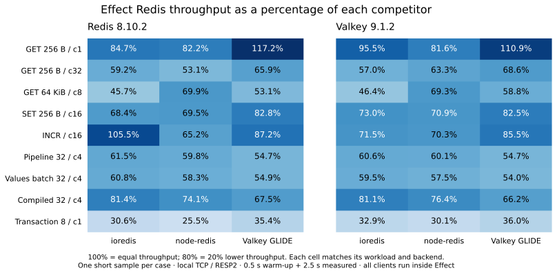

# Redis client benchmarks

A short comparison of the Node.js implementation of `@effect-kit/redis` with **ioredis**, **node-redis**, and **Valkey GLIDE**, against both Redis and Valkey servers. Valkey is the server; Valkey GLIDE is the client library.

Measured source: `292f540d31c687b8182cb8ebd097b2ca5ef090f2`. Run `cadc40f7-73a8-4491-aad1-4535ff70f85b`, completed 2026-10-29T22:47:00.509Z. The matrix completed **72 fresh-process measurements** in **239 seconds** after the recorded start, covering nine workloads, four clients and two servers. Build/prerequisite checks run before that timer.

**This is a short run, with one 2.5-second sample after a 0.5-second warm-up per combination.** Values below are individual observations, not repeated-trial medians. There are no confidence intervals or stable production rankings. Only the completed matrix identified above contributes to the report.

## Findings

- **Compiled plans versus ioredis:** -18.6% throughput on Redis and -18.9% on Valkey in this run. Each competitor uses its ordinary pipeline for this case.
- **Values batches versus ioredis:** -39.2% throughput on Redis and -40.5% on Valkey in this run. Each competitor uses its ordinary pipeline for this case.
- **The percentage gap depends on the operation.** The compiled-plan result does not describe sequential commands, large replies, writes or transactions. See the per-workload tables before choosing an aggregate.
- **Client policies differ.** node-redis uses automatic pipelining; ioredis and Effect Redis do not. GLIDE retains native multiplexing. Effect Redis pipelines use a session pool; its new values batches and compiled plans use the shared ordinary connection.



The figure shows the percentage of each competitor’s throughput: **100% means equal throughput; 80% means 20% lower throughput**. Each cell compares the matching workload and backend.

## Versions and environment

| Client       | Measured version                                     |
| ------------ | ---------------------------------------------------- |
| Effect Redis | 0.1.0 (development build at the source commit above) |
| ioredis      | 6.0.0                                                |
| node-redis   | 6.3.0                                                |
| Valkey GLIDE | 2.5.3                                                |

The Effect Redis package declares version `0.1.0`; these measurements include the development batch/compiled APIs and do **not** certify that the published version of the same number contains those APIs.

| Setting          | Value                                                                              |
| ---------------- | ---------------------------------------------------------------------------------- |
| Host             | Apple M3 Pro; 11 logical CPUs; 18 GiB RAM                                          |
| Host platform    | darwin / arm64, kernel 25.6.0                                                      |
| Runtime          | Node.js 24.22.0; Effect 4.0.6                                                      |
| Servers          | Redis 8.10.2; Valkey 9.1.2; pinned Docker fixtures                                 |
| Network          | TCP through host loopback and published Docker ports; RESP2                        |
| Load             | Closed-loop workers at the listed concurrency                                      |
| Client lifetime  | One fresh Node process per measured combination; only the selected driver imported |
| Trials           | One per client/workload/backend                                                    |
| Warm-up / sample | 500 ms / 2,500 ms                                                                  |
| Construction     | Reuse the operation Effect; fixed batch descriptors                                |
| Telemetry        | Disabled for Effect Redis                                                          |

The fixtures disable RDB snapshots (`save ""`) and AOF (`appendonly no`); this run measures in-memory operations, not persistence or durability. Docker networking and the host’s VM overhead are included. This is not a native Linux server or remote-network test. Image digests, actual server build strings, configuration digests, exact policies and source fingerprints are in [the run manifest](benchmarks/run.json).

## Workloads

`cN` means N concurrent operations. A batch or transaction is one operation containing multiple application commands.

| Workload             | Concurrency | Commands / operation | Payload                         |
| -------------------- | ----------: | -------------------: | ------------------------------- |
| GET 256 B / c1       |           1 |                    1 | 256-byte binary reply           |
| GET 256 B / c32      |          32 |                    1 | 256-byte binary reply           |
| GET 64 KiB / c8      |           8 |                    1 | 65,536-byte binary reply        |
| SET 256 B / c16      |          16 |                    1 | 256-byte write                  |
| INCR / c16           |          16 |                    1 | one integer reply               |
| Pipeline 32 / c4     |           4 |                   32 | 32 GETs, 256-byte replies       |
| Values batch 32 / c4 |           4 |                   32 | 32 GETs, 256-byte replies       |
| Compiled 32 / c4     |           4 |                   32 | 32 fixed GETs, 256-byte replies |
| Transaction 8 / c1   |           1 |                    8 | 8 GETs in MULTI/EXEC            |

The values-batch and compiled rows select different APIs only for Effect Redis. ioredis, node-redis and GLIDE run their normal non-atomic batches for all three 32-command rows. Those are separate measurements of the same competitor API; differences between its rows can reflect short-run variability. Do not count those repeated variants as independent workload types in an overall average.

Each single-command case uses one hot key; the 32-command batches repeatedly read the same key. This is not a large keyspace or cache-miss distribution.

GETs request binary output. Effect Redis unwraps `Option`; all clients return the same expected bytes to verification. INCR runs safely within the exact-number range: Effect Redis returns `bigint`, while competitor drivers may return a safe number. It therefore includes different integer/type-safety policies. SET checks successful replies but does not independently read back every write. The transaction uses GETs to isolate MULTI/EXEC overhead; it does not benchmark write durability, conflicts or rollback behavior.

## Throughput

**Application Redis commands per second; higher is better.** The denominator is measured inside the Effect program, from worker launch through join, including reply verification and final drain. Connection setup, fixture data and compilation are outside the sample. A pipeline counts 32 GETs and a transaction counts eight GETs; MULTI/EXEC are not added to application-command counts.

### Redis server

| Workload             | Effect Redis | ioredis | node-redis | Valkey GLIDE |
| -------------------- | -----------: | ------: | ---------: | -----------: |
| GET 256 B / c1       |        9,857 |  11,632 |     11,985 |        8,410 |
| GET 256 B / c32      |       93,453 | 157,987 |    175,885 |      141,907 |
| GET 64 KiB / c8      |       14,201 |  31,093 |     20,303 |       26,742 |
| SET 256 B / c16      |       72,937 | 106,613 |    104,885 |       88,105 |
| INCR / c16           |       75,170 |  71,282 |    115,336 |       86,208 |
| Pipeline 32 / c4     |      265,750 | 432,256 |    444,669 |      486,235 |
| Values batch 32 / c4 |      267,563 | 440,193 |    458,870 |      487,036 |
| Compiled 32 / c4     |      349,373 | 429,027 |    471,442 |      517,894 |
| Transaction 8 / c1   |       18,356 |  60,022 |     72,106 |       51,894 |

### Valkey server

| Workload             | Effect Redis | ioredis | node-redis | Valkey GLIDE |
| -------------------- | -----------: | ------: | ---------: | -----------: |
| GET 256 B / c1       |        9,522 |   9,975 |     11,670 |        8,582 |
| GET 256 B / c32      |       95,612 | 167,704 |    151,057 |      139,295 |
| GET 64 KiB / c8      |       14,843 |  31,971 |     21,404 |       25,239 |
| SET 256 B / c16      |       72,178 |  98,918 |    101,829 |       87,505 |
| INCR / c16           |       76,895 | 107,590 |    109,429 |       89,966 |
| Pipeline 32 / c4     |      267,006 | 440,249 |    444,368 |      488,205 |
| Values batch 32 / c4 |      267,071 | 448,790 |    464,133 |      494,771 |
| Compiled 32 / c4     |      352,835 | 434,864 |    462,031 |      532,820 |
| Transaction 8 / c1   |       20,025 |  60,775 |     66,583 |       55,556 |

## Relative throughput and averages

For each case, relative change is `100 × (Effect Redis throughput / competitor throughput - 1)`. A negative value means Effect Redis completed fewer commands per second; this is not a latency percentage.

The seven-workload aggregate is the geometric mean of throughput ratios over sequential GET, concurrent small GET, large GET, SET, INCR, the existing pipeline and transaction. Each workload gets equal weight. The two additional batch variants are excluded to avoid triple-weighting pipelined GETs. This is a descriptive cross-workload aggregate of a single run, not a statistical estimate or an application-specific average.

| Scope                        | vs ioredis | vs node-redis | vs Valkey GLIDE |
| ---------------------------- | ---------: | ------------: | --------------: |
| Redis / seven existing APIs  |     -39.1% |        -42.4% |          -33.6% |
| Redis / values batch         |     -39.2% |        -41.7% |          -45.1% |
| Redis / compiled plan        |     -18.6% |        -25.9% |          -32.5% |
| Valkey / seven existing APIs |     -40.5% |        -38.8% |          -32.7% |
| Valkey / values batch        |     -40.5% |        -42.5% |          -46.0% |
| Valkey / compiled plan       |     -18.9% |        -23.6% |          -33.8% |

Across both backends and the seven existing API workloads (14 equally weighted cases), the descriptive geometric-mean changes are **-39.8% versus ioredis, -40.6% versus node-redis, -33.1% versus Valkey GLIDE**. Use the separate compiled-plan row when evaluating fixed reusable batches.

## Operation latency

**p99 in milliseconds from `Effect.timed(operation.effect)` inside the worker; lower is better.** For a pipeline/batch/transaction this is latency for the complete operation, not for one constituent GET. Verification is outside this latency boundary, although included in throughput. The CSV also contains p50, p95, a separate `performance.now()` operation p99, and verification-inclusive p99.

### Redis server

| Workload             | Effect Redis | ioredis | node-redis | Valkey GLIDE |
| -------------------- | -----------: | ------: | ---------: | -----------: |
| GET 256 B / c1       |        0.191 |   0.235 |      0.142 |        0.283 |
| GET 256 B / c32      |        1.732 |   0.395 |      0.302 |        0.400 |
| GET 64 KiB / c8      |        1.760 |   1.016 |      1.368 |        1.095 |
| SET 256 B / c16      |        0.597 |   0.223 |      0.281 |        0.273 |
| INCR / c16           |        0.540 |   0.948 |      0.440 |        0.322 |
| Pipeline 32 / c4     |        2.418 |   2.759 |      0.851 |        0.843 |
| Values batch 32 / c4 |        2.273 |   2.790 |      0.568 |        0.817 |
| Compiled 32 / c4     |        1.779 |   2.881 |      0.539 |        0.809 |
| Transaction 8 / c1   |        0.995 |   0.211 |      0.162 |        0.211 |

### Valkey server

| Workload             | Effect Redis | ioredis | node-redis | Valkey GLIDE |
| -------------------- | -----------: | ------: | ---------: | -----------: |
| GET 256 B / c1       |        0.158 |   0.157 |      0.118 |        0.156 |
| GET 256 B / c32      |        1.029 |   0.359 |      0.399 |        0.395 |
| GET 64 KiB / c8      |        1.608 |   1.017 |      1.320 |        1.214 |
| SET 256 B / c16      |        0.428 |   0.280 |      0.247 |        0.269 |
| INCR / c16           |        0.496 |   0.274 |      0.228 |        0.273 |
| Pipeline 32 / c4     |        2.595 |   2.632 |      0.773 |        0.791 |
| Values batch 32 / c4 |        2.269 |   2.634 |      0.491 |        0.876 |
| Compiled 32 / c4     |        1.730 |   2.823 |      0.500 |        0.813 |
| Transaction 8 / c1   |        0.939 |   0.174 |      0.164 |        0.190 |

These percentiles describe requests that completed during one short closed-loop sample. They are not confidence bounds, coordinated-omission-corrected service latencies, or open-loop production SLOs. Latency percentiles must not be summed or compared as if batch size were one.

## CPU and memory

Representative cases below; every scenario is included in [the trial CSV](benchmarks/trials.csv). CPU microseconds per application command are `(user + system CPU microseconds) / completedCommands`, using the measured client process. RSS is sampled every 25 ms; the maximum sample is shown in MiB.

| Backend / workload        | Client       | CPU µs / command | Peak RSS MiB | GC ms |
| ------------------------- | ------------ | ---------------: | -----------: | ----: |
| redis / GET 256 B / c32   | Effect Redis |            13.20 |        348.3 | 118.6 |
| redis / GET 256 B / c32   | ioredis      |             6.93 |        349.2 | 119.9 |
| redis / GET 256 B / c32   | node-redis   |             4.15 |        554.5 | 122.3 |
| redis / GET 256 B / c32   | Valkey GLIDE |            11.66 |        238.7 |  17.4 |
| redis / GET 64 KiB / c8   | Effect Redis |           185.73 |        283.4 | 289.0 |
| redis / GET 64 KiB / c8   | ioredis      |            49.99 |        299.4 | 127.6 |
| redis / GET 64 KiB / c8   | node-redis   |           126.51 |        313.6 | 319.9 |
| redis / GET 64 KiB / c8   | Valkey GLIDE |            58.21 |        384.9 |  71.6 |
| redis / Compiled 32 / c4  | Effect Redis |             3.70 |        388.5 | 124.4 |
| redis / Compiled 32 / c4  | ioredis      |             3.48 |        395.8 | 305.4 |
| redis / Compiled 32 / c4  | node-redis   |             1.64 |        409.2 | 127.3 |
| redis / Compiled 32 / c4  | Valkey GLIDE |             2.71 |        203.1 |  41.0 |
| valkey / GET 256 B / c32  | Effect Redis |            12.90 |        317.1 |  73.6 |
| valkey / GET 256 B / c32  | ioredis      |             5.36 |        268.6 |   7.3 |
| valkey / GET 256 B / c32  | node-redis   |             6.46 |        568.1 | 237.1 |
| valkey / GET 256 B / c32  | Valkey GLIDE |            11.63 |        237.2 |  17.2 |
| valkey / GET 64 KiB / c8  | Effect Redis |           170.74 |        303.7 | 279.1 |
| valkey / GET 64 KiB / c8  | ioredis      |            50.70 |        299.4 | 133.8 |
| valkey / GET 64 KiB / c8  | node-redis   |           120.97 |        313.0 | 317.1 |
| valkey / GET 64 KiB / c8  | Valkey GLIDE |            58.98 |        387.0 |  70.5 |
| valkey / Compiled 32 / c4 | Effect Redis |             3.69 |        379.5 | 124.5 |
| valkey / Compiled 32 / c4 | ioredis      |             3.47 |        391.2 | 300.1 |
| valkey / Compiled 32 / c4 | node-redis   |             1.62 |        410.9 | 122.1 |
| valkey / Compiled 32 / c4 | Valkey GLIDE |             2.59 |        202.7 |  42.4 |

These are client-process observations, not total-machine or server resource usage. The harness, Effect imports, retained latency samples and native allocations contribute to RSS. Latency collection preallocates three bounded arrays in this lane; RSS is not a library-only or retained-memory measurement. JS heap alone does not cover GLIDE native allocations. GC timing is observed during the sample and is not forcibly removed from results. Throughput and memory can trade off; a lower RSS value alone does not establish better efficiency.

## Connection and execution policies

| Scenario / observed peak Node sockets | Effect Redis | ioredis | node-redis |        Valkey GLIDE |
| ------------------------------------- | -----------: | ------: | ---------: | ------------------: |
| Concurrent GET                        |            1 |       1 |          1 | native-not-observed |
| Existing pipeline                     |            5 |       1 |          1 | native-not-observed |
| Values batch                          |            1 |       1 |          1 | native-not-observed |
| Compiled plan                         |            1 |       1 |          1 | native-not-observed |
| Transaction                           |            2 |       1 |          1 | native-not-observed |

Socket counts above are observed in the Redis-server cases; backend-specific observations are retained in the CSV and manifest. GLIDE’s native connection creation is outside the Node socket hook and is reported as `native-not-observed`, never assumed to be one.

- **Effect Redis:** one ordinary connection; up to four leased session connections for the existing pipeline API. The ordinary setup connection can remain open while session connections are used. Values batches and compiled plans share the ordinary FIFO connection. Transactions use an exclusive session. Request deadlines, admission limits, scoped ownership, typed reply decoding and exact integers remain enabled.
- **ioredis:** automatic pipelining disabled, offline queue disabled, retries/reconnect disabled, ten-second command timeout. Batches are constructed and executed through its normal pipeline API.
- **node-redis:** automatic pipelining enabled, offline queue disabled, reconnect disabled, ten-second command timeout. Binary replies use Buffer mapping. Its EXEC path converts returned ASCII strings back to bytes inside the sample because this installed version does not apply the Buffer mapping there.
- **Valkey GLIDE:** RESP2, binary decoder, native multiplexing, ten-second request timeout and the driver’s default reconnect policy. Its normal Batch API is non-atomic for pipelines and atomic for the transaction case. No reconnect event is intentionally injected.

In `reuse` mode, Effect Redis reuses the operation Effect and command descriptors. Competing drivers construct a fresh pipeline/Batch per execution where their API requires it. Compiled plans have fixed arguments and warmed native encoding; changing arguments requires a new plan. This measures the public APIs, not hand-written prepared requests for every driver.

These settings compare usable client APIs with their stated policies, not identical scheduling or socket engines. In particular, the ordinary concurrent GET/SET/INCR rows include node-redis automatic batching behavior. This run cannot isolate “Effect overhead” from protocol implementation, ownership checks, return types, socket scheduling or native code.

## Timing and validation

1. Each fresh child initializes the selected client, connection, unique fixture keys and any compiled plan before warm-up. Setup and teardown are outside the measured operation loop.
2. Warm-up runs the same operation for 500 ms, followed by explicit GC before sampling. There is no forced GC inside the sample.
3. One `Effect.runPromise` surrounds the complete concurrent worker program. Effect Redis executes reusable native Effects; competitor Promises are bridged with `Effect.tryPromise`. There is no runtime runner call per Effect Redis command. This is a comparison of clients used from an Effect application, not their maximum Promise-only throughput.
4. `Effect.timed` measures the same submitted operation before reply verification. The primary throughput timer is inside that worker program. Both inner/outer throughput and verified/unverified operation timing are preserved in the CSV.
5. Every GET/batch response is checked for expected bytes and count; invalid, missing or erroneous replies fail the run. Integer replies must be valid positive bigint/safe integers. Counts and durations are checked, as are client/runtime identities and the complete expected matrix. This success-path verification does not test every possible Redis failure semantic.
6. Samples are stored exactly in bounded arrays, not sampled by dropping slow requests; overflow fails. Each timing collection count equals completed operations, and application-command counts match batch sizes.
7. The runner fingerprints built artifacts, benchmark code, support/fixtures and dependency manifests before and after the run. The digest remained unchanged. The checkout was clean at measurement start. Fixtures are isolated Testcontainers servers; clients and samples run sequentially.

Client order is deterministic. With one trial, it is Effect Redis, ioredis, node-redis, then GLIDE in every scenario; the runner rotates order only when repeated trials are requested. Redis runs before Valkey. Order, host activity and thermal state can bias a short run, so do not treat small differences as significant or use this run to rank the two server engines. No simultaneous benchmark, build or unrelated test run was intentionally started during measurement.

## Reproduce

Use the repository’s pinned Node/pnpm versions, install dependencies and prepare the Docker images:

```sh
pnpm install --frozen-lockfile
pnpm fixtures:check
pnpm fixtures:pull
pnpm bench:clients --engine all --execution effect --client all --workload all --trials 1 --warmup-ms 500 --sample-ms 2500 --latency-clock effect --construction reuse --session-connections 4
```

The short matrix allocates 216 seconds to warm-up and measured windows (72 × 3 seconds); fresh-process, verification, fixture and build overhead add to wall time. Budget approximately five minutes on the recorded host, not an exact deadline guarantee.

For a more stable comparison, raise the trial count and sample duration. For example, `--trials 5 --warmup-ms 1000 --sample-ms 5000` takes roughly 35–40 minutes for this full matrix. Do not mix those results into this single-trial report. The harness also supports `--construction call` for construction-cost controls and a separate Promise execution lane; neither is included here. A single session connection can be selected with `--session-connections 1` to study pool-policy effects in a separate run.

## Evidence and scope

- [Complete per-combination measurements](benchmarks/trials.csv): all 72 observations, inner/outer throughput, p50/p95/p99, CPU, memory, GC and socket counts.
- [Run metadata and source hashes](benchmarks/run.json): settings, versions, servers, image/configuration digests, completeness and SHA-256 hashes of the original local receipts and exported CSV.
- [Relative-throughput figure](benchmarks/relative-throughput.svg): derived from the same observations, with no historical samples blended in.
- Benchmark implementation: [runner](packages/redis/test/runners/benchmarks/run.ts), [operation adapters](packages/redis/test/runners/benchmarks/clients), [timing](packages/redis/test/runners/benchmarks/Measurement.ts), [verification](packages/redis/test/runners/benchmarks/Operation.ts).

The full original JSON receipts remain in ignored local `packages/redis/test/results/benchmarks/cadc40f7-73a8-4491-aad1-4535ff70f85b/`. The compact CSV and metadata above are the tracked public evidence. Incomplete and historical runs contribute no observations to the tables or aggregates.

This run covers success-path local TCP commands on the two recorded server versions. It does not cover Bun, HTTP/Upstash, Cluster, Sentinel, TLS, WAN latency, persistence settings, failover, reconnection, error recovery, cancellation, Streams/Pub/Sub, pipelined writes or transactions with conflicting writes. Those require different workloads and fixtures. Compatibility and correctness test results are separate from throughput evidence.
